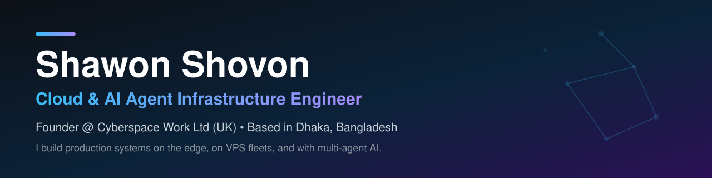

# Hi, I'm Shawon Shovon 👋

**Cloud & AI Agent Infrastructure Engineer** · Founder & CEO, **Cyberspace Work** · Dhaka, Bangladesh 🇧🇩

I don't just learn cloud tools — I design, deploy, secure, and run production systems with them:
edge platforms on Cloudflare, self-hosted infrastructure on Linux servers, and multi-agent AI
systems that do real work every day.

> **Automation first. Ownership over dependency. Verify before you claim.**

---

## ⚡ What I Do

- **Cloud & Edge Infrastructure** — Cloudflare Workers, Containers, D1, R2, KV, Queues & Workflows; Linux VPS fleets with Docker and nginx
- **AI Agent Systems** — Multi-agent orchestration, MCP servers, agent gateways with cost controls, browser automation, and long-running autonomous workflows
- **Self-Hosted Platforms** — Private cloud (Nextcloud / ownCloud), SMTP mail servers, VPNs, and business tooling you own instead of rent
- **Content Intelligence Pipelines** — Large-scale ingestion systems that turn video and web content into searchable, structured knowledge

---

## 🚀 Flagship Systems

| System | What it is | Built with |
|---|---|---|
| **Cloudflare Agent Platform** | A multi-agent "agent factory" running on the edge — an API gateway with caching, a cost ledger and a kill-switch, browser automation, data pipelines, and scheduled ops monitoring | Cloudflare Workers · Containers · D1 · R2 · KV · Queues · Workflows · TypeScript |
| **AI Agents Content Engine** | A pipeline tracking **180 verified YouTube channels**, turning new videos into searchable transcripts and PDFs in object storage, with a daily new-content check | Python · yt-dlp · Speech-to-text APIs · Cloudflare R2 · Cron |
| **Self-Hosted Client Infrastructure** | Production setups delivered for clients: private cloud, bulk SMTP servers, self-hosted VPNs, and multi-agent architecture (Hermes / OpenClaw / Pi) — rated **5.0 ★ on Fiverr** | Linux · Docker · Nextcloud · Postfix · WireGuard-style VPN · Multi-agent stacks |

*Architecture notes and sanitized case studies are published here as standalone repos — internals, credentials, and client data never are.*

---

## 🧰 My Stack

| Layer | Tools |
|---|---|
| **Cloud & Edge** | Cloudflare (Workers, Containers, D1, R2, KV, Queues, Workflows) · AWS · Microsoft Azure · Google Cloud |
| **Servers & DevOps** | Linux (Ubuntu) · Docker · Docker Compose · nginx · systemd · Cron · GitHub |
| **AI & Agents** | Multi-agent orchestration · MCP (Model Context Protocol) · LLM gateways (BYOK) · Paperclip · Hermes · OpenClaw · Pi |
| **Self-Hosted** | Nextcloud / ownCloud · SMTP mail servers · VPN · Obsidian knowledge systems · Postiz |
| **Languages** | TypeScript · Python · Bash |

---

## 🛠️ How I Work

1. **Design the system first** — diagram, guardrails, and failure points before a single line of code
2. **Build the smallest useful version** — visible result first, optimise second
3. **Secure by default** — authenticated endpoints, least privilege, no secrets in code or chat
4. **Verify, then claim** — a system is "live" only after an end-to-end check proves it
5. **Document everything** — so any system can be understood, handed over, and rebuilt

---

## 🌱 Currently Building

- Production multi-agent workflows for lead generation, marketing automation, and task automation
- A personal AI operating system — an assistant that holds context, projects, and preferences across every tool I use
- Reusable agent infrastructure other builders can run on the Cloudflare edge

---

## 🤝 Work With Me

- 🌐 Portfolio: [shawon.cyberspacework.com](https://shawon.cyberspacework.com)
- 💼 Fiverr: **@ameliasofi** — private cloud, SMTP servers, self-hosted VPN, multi-agent architecture
- 🏢 Company: **Cyberspace Work** — AI-powered productivity systems, automation workflows, and digital products

If you need cloud infrastructure that actually ships — or an AI agent system that survives
contact with production — that's exactly what I build.
